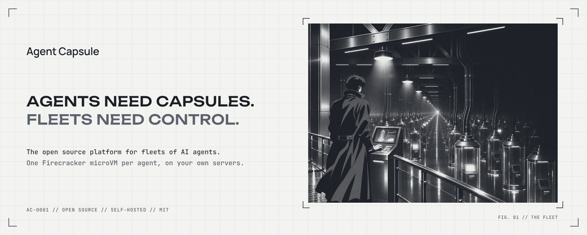

<p align="center">
  <picture>
    <source media="(prefers-color-scheme: dark)" srcset="docs/assets/readme/hero-dark.png">
    <source media="(prefers-color-scheme: light)" srcset="docs/assets/readme/hero-light.png">
    
  </picture>
</p>

<p align="center">
  <strong>The open source platform for fleets of AI agents.</strong><br>
  Each agent runs in its own Firecracker microVM, on infrastructure you control.
</p>

<p align="center">
  <a href="ROADMAP.md"></a>
  <a href="LICENSE"></a>
  
  
</p>

<p align="center">
  <a href="#what-works-today">What works</a> ·
  <a href="#architecture">Architecture</a> ·
  <a href="#building-and-testing">Build</a> ·
  <a href="#documentation">Docs</a> ·
  <a href="ROADMAP.md">Roadmap</a>
</p>

---

Agent Capsule is not an AI agent. It is the self-hosted platform that runs a fleet
of them: it treats each agent as a real computing resource, isolated, persistent,
administered and governed.

Every agent gets a **capsule**, a microVM with a private encrypted volume that sleeps
when idle and wakes when work arrives. Organizations manage members, teams and
agents; who may invoke an agent or read its results is decided by explicit
assignments, never by an administrative role. Agents call models through a gateway
that keeps provider credentials outside the VM and enforces budgets. The platform
hosts and governs; the harness you bring decides what the agent does.

> [!WARNING]
> **Pre-MVP, not for production.** The core path is implemented and tested on real
> KVM, but several MVP areas (restore onto another host, release validation, parts
> of operations) are missing. See [ROADMAP.md](ROADMAP.md).

## Core ideas

| Term | Meaning |
|---|---|
| **Agent** | A durable resource owned by an organization, not a process. Stopping it is not deleting it. |
| **Capsule** | The isolated environment an agent runs in: one Firecracker microVM, one encrypted volume. |
| **Harness** | The software that runs inside the capsule, in any language, shipped as a signed OCI package. |
| **Invocation** | A task sent to an agent, queued, delivered in order and answered privately. |
| **Assignment** | The explicit permission for someone to see, invoke or read an agent. |
| **Mandate** | A bounded authorization for one agent to delegate work to another. |

## What works today

**Run**

- **Capsules**: cold creation, wake/sleep/delete with guest-acknowledged quiescence,
  one writer generation per volume, encrypted volumes, jailed Firecracker VMMs,
  crash recovery of the worker and of PostgreSQL.
- **Invocations**: idempotent admission, per-agent FIFO delivery, TTLs, queue limits,
  dead letters, scheduled invocations, idle closure, and private results that only
  the requester can read. Agents that need to call the platform answer `working` and
  post their result later.
- **Attachments**: files up to 8 MiB, encrypted per segment, usable once by their
  uploader, readable from the guest while the invocation runs, purged afterwards.

**Govern**

- **Organizations and access control**: organizations, members, teams, roles, service
  accounts, and per-agent assignments (`read_metadata`, `invoke`, `read_content`).
  Users authenticate with delegated JWTs from the organization's identity provider.
- **LLM gateway**: OpenAI-compatible and Anthropic providers, model aliases,
  encrypted provider credentials, hard/soft token budgets, usage reports.
- **Harness registry**: harness packages are imported from approved OCI registries
  (public or private) by digest, checked against trusted publisher signatures (cosign
  format), cached read-only and published as immutable releases; agents on a release
  share its image, attached read-only and run chrooted in the guest. Agents can be
  upgraded and rolled back, and unused packages leave the cache.

**Connect**

- **Inter-agent requests** with recipient consent and bounded mandates, over A2A,
  the AGNTCY Directory and SLIM ([docs/interop.md](docs/interop.md)).
- **Harnesses in any language**: Go, or Python with the
  [Python SDK](sdk/python/README.md).
- **Unmodified agents**: `capsule-adapter` runs an existing agent's command for each
  invocation and serves the OpenAI and Anthropic APIs on the VM's loopback, so the
  agent's own SDK reaches the organization's models through the platform, tools
  included, with no credential in the VM ([docs/adapter.md](docs/adapter.md)).

## Architecture

```
            HTTPS (delegated JWT, idempotency keys)
 clients ─────────────────────────────► agentcapsule-api ──┐
                                                           │
                                         PostgreSQL ◄──────┤  control plane
                                                           │  (organizations, queues,
                                       agentcapsule-worker ┘   transit, budgets)
                                          │   │
                     control channel      │   │  platform channel (guest → host:
                     (host → guest:       │   │  peers, LLM, attachments, results)
                      invoke, quiesce)    ▼   ▲
                                   ┌──────────────────────────┐
                                   │ Firecracker microVM      │
                                   │  capsule-init (PID 1)    │
                                   │  harness (agent runtime) │
                                   │  encrypted data volume   │
                                   └──────────────────────────┘
```

| Binary | Role |
|---|---|
| `agentcapsule-api` | The HTTP API ([OpenAPI 3.1](openapi/openapi.yaml)). |
| `agentcapsule-worker` | Places and supervises VMs, delivers work, serves the platform channel, provisions encrypted volumes. |
| `agentcapsule-admin` | Local, trusted installation commands (bootstrap, keys, host configuration). No network listener. |
| `agentcapsule-authority` | The replica of the key and restore authorities on the standby host ([recovery.md](docs/recovery.md#the-authorities-replica-d-05)). |
| `agentcapsule-harness` | Builds and publishes harness packages (developer/CI tool). |
| `capsule-init` | PID 1 in the guest; holds boot credentials and volume secrets away from the harness and relays its platform calls. |
| `capsule-adapter` | Runs an unmodified agent as a harness (command per invocation, model endpoint on the guest loopback). |
| `capsule-echo` | The reference harness used by tests. |

The delivery, messaging, lifecycle, revocation and deferred-result protocols are
specified as [Quint models](spec/), and traces from those models are replayed
against the implementation in the test suite.

## Requirements

- Linux amd64 with KVM (for running capsules), Go **1.27.3**, a C compiler and the
  `libcryptsetup` headers (cgo), PostgreSQL 16 or newer.
- Firecracker 1.17.0 with the volume-lock patch in [runtime/firecracker](runtime/firecracker),
  a guest kernel built from [runtime/guest](runtime/guest), and the guest image built
  by `scripts/build-product-guest.py`.

## Building and testing

```bash
go build ./cmd/...
go test -race ./...            # PostgreSQL-backed tests skip without a database
```

The test runners create their own throwaway environments and never touch an
existing database:

```bash
# Full integration on a private PostgreSQL cluster, with WAL crash recovery
python3 scripts/verify-postgres.py --pg-bin /usr/lib/postgresql/16/bin --native-tools /

# Optional: live LLM checks against a local OpenAI-compatible server (e.g. Ollama)
python3 scripts/verify-postgres.py --pg-bin /usr/lib/postgresql/16/bin --native-tools / \
  --llm-base-url http://127.0.0.1:11434/v1 --llm-model tinyllama:latest
```

KVM campaigns (real jailed VMs, needs root for the jailer and cgroups) are
described in [scripts/README.md](scripts/README.md).

## Running

Installation is not packaged yet. The building blocks are documented:

- [docs/api/README.md](docs/api/README.md): API server, bootstrap and accounts.
- [docs/api/tenant-identity.md](docs/api/tenant-identity.md): trusting an
  organization's identity provider.
- [docs/worker.md](docs/worker.md): worker configuration
  ([example](runtime/worker/config.example.json)), maintenance and delivery.
- [docs/guest/](docs/guest/): guest image, control contract, keys and volumes.

Example harnesses live in [examples/](examples/): `python-echo`, `go-echo`, an
OpenAI SDK agent run unchanged (`adapted-agent`), the Pi coding agent (`pi-agent`)
and an A2A agent (`a2a-agent`).

## Documentation

| Topic | Where |
|---|---|
| Product goals and MVP requirements | [docs/product.md](docs/product.md) |
| Status and remaining work | [ROADMAP.md](ROADMAP.md) |
| HTTP API | [openapi/openapi.yaml](openapi/openapi.yaml), [docs/api/](docs/api/) |
| Agents, assignments, invocations, attachments, deferred results | [docs/api/agents-assignments.md](docs/api/agents-assignments.md) |
| LLM gateway | [docs/api/llm.md](docs/api/llm.md) |
| Harness packages, publishing and imports | [docs/registry.md](docs/registry.md) |
| Running an existing agent unchanged | [docs/adapter.md](docs/adapter.md) |
| Guest runtime and the `capsule.v1` contract | [docs/guest/](docs/guest/) |
| Interoperability profile (A2A, OASF, Directory, SLIM) | [docs/interop.md](docs/interop.md) |
| Backup, restore and recovery | [docs/recovery.md](docs/recovery.md) |
| Architecture decisions | [docs/adr/](docs/adr/) |
| Formal models | [spec/](spec/) |
| Build, test and verification scripts | [scripts/README.md](scripts/README.md) |

<details>
<summary><strong>Repository layout</strong></summary>

```
cmd/          binaries (api, worker, admin, authority, harness tool, capsule-init, capsule-echo, capsule-adapter)
internal/     Go packages: controlplane, api, worker, runtime, capsuleprotocol, ...
openapi/      canonical OpenAPI 3.1 contract
spec/         Quint protocol models
docs/         product, API, guest, worker and interop documentation, ADRs
runtime/      Firecracker patch, guest kernel config, example configs, interop qualification
deploy/       private interoperability services, backup, standby, monitoring and systemd units
scripts/      builds, CI checks and KVM/PostgreSQL verification campaigns
sdk/python/   Python harness SDK (capsule.v1, standard library only)
examples/     example harnesses and adapted agents
.dagger/      reference Dagger module: builds, publishes, signs and verifies harnesses
```

</details>

## Contributing

Contributions are welcome. Read [CONTRIBUTING.md](CONTRIBUTING.md) first; report
security issues privately as described in [SECURITY.md](SECURITY.md).

## License

[MIT](LICENSE). Harnesses keep their own license.
